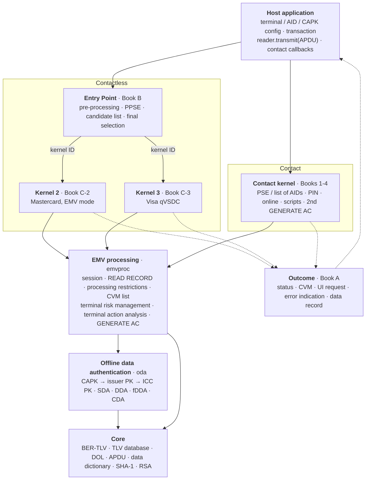
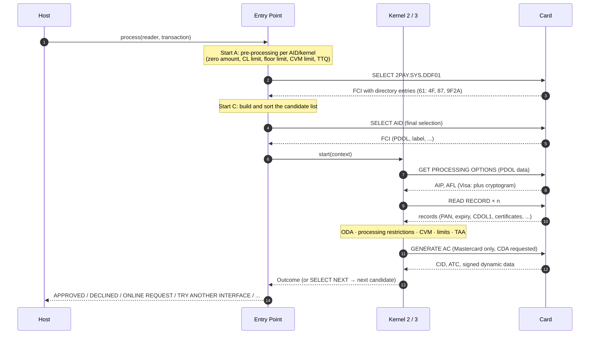
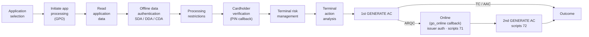
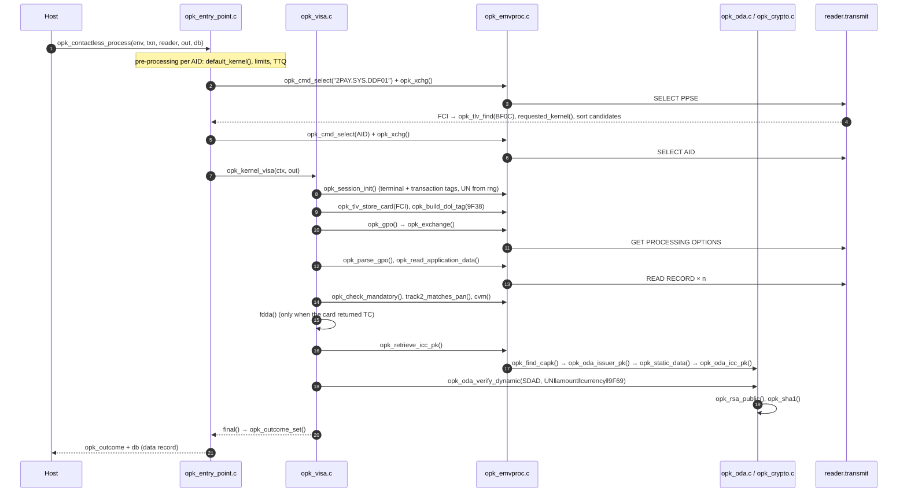
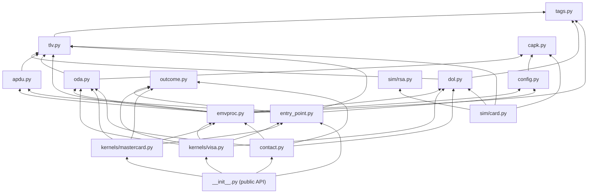
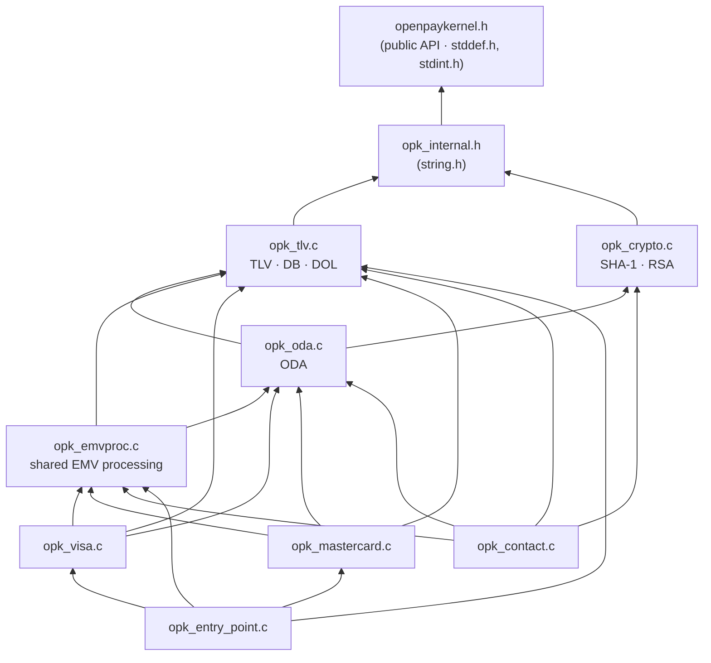
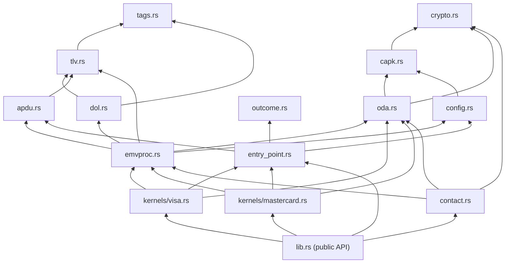
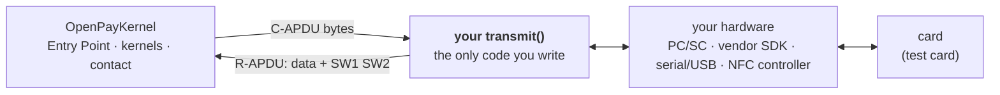
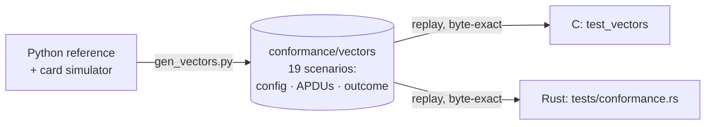

# OpenPayKernel: an open-source EMV Level 2 kernel

OpenPayKernel is a clean-room, open-source implementation of the EMV Level 2 payment
kernel. It comes as three implementations that behave the same way, byte for byte:

| | Python (`python/openpaykernel`) | C99 (`c/`) | Rust (`rust/`) |
|---|---|---|---|
| Purpose | Reference, test bed, simulation, tooling | Embedded terminals: no malloc, no dependencies | Memory-safe kernel: `#![no_std]` + `alloc`, `forbid(unsafe_code)`, no dependencies |
| Contact EMV (Books 1-4) | ✅ | ✅ | ✅ |
| Contactless Entry Point (Book B) | ✅ | ✅ | ✅ |
| Kernel 3: Visa qVSDC (Book C-3) | ✅ | ✅ | ✅ |
| Kernel 2: Mastercard EMV mode (Book C-2) | ✅ | ✅ | ✅ |
| ODA: SDA / DDA / fDDA / CDA (RSA, SHA-1) | ✅ | ✅ | ✅ |
| Card simulator + key/certificate generator | ✅ | n/a (replays the vectors) | n/a (replays the vectors) |
| Conformance vectors (19 scenarios) | generates them | ✅ byte-identical | ✅ byte-identical |

> [!CAUTION]
> **For study and research only. Do not use it to move real money.**
> OpenPayKernel is an educational project. It is **not certified** by EMVCo or any payment
> brand, has **not** been security-audited, and is **not guaranteed to be bug-free**. Payment
> software handles people's money: a defect can approve a transaction that should be
> declined, leak cardholder data, or block a card. It is provided "AS IS", without warranty
> of any kind. Read the full [Disclaimer](#disclaimer) before you use it.

## Kernel structure

### Layers

The host application talks to the kernel through only three things: configuration, an
APDU `transmit` function and (for contact) a few callbacks. Everything below that is
layered so that both interfaces share the same EMV processing and cryptography.



### Contactless transaction flow



### Contact transaction flow



### Module map (Python ↔ C ↔ Rust)

Each Python module has a matching C file and Rust module, and the shared conformance vectors keep all three behaving the same.

| Layer | Python `python/openpaykernel/` | C `c/src/` | Rust `rust/src/` | Specification |
|---|---|---|---|---|
| Public API | `__init__.py` | `include/openpaykernel/openpaykernel.h` | `lib.rs` | — |
| TLV, TLV database, DOL, data dictionary | `tlv.py`, `dol.py`, `tags.py` | `opk_tlv.c` | `tlv.rs`, `dol.rs`, `tags.rs` | Book 3 Annex A/B, §5.4 |
| APDU commands, reader interface | `apdu.py` | `opk_emvproc.c` | `apdu.rs` | Book 3 §6 |
| SHA-1, RSA | `hashlib`, `pow()` | `opk_crypto.c` | `crypto.rs` | Book 2 Annex B |
| CAPK store, ODA | `capk.py`, `oda.py` | `opk_oda.c` | `capk.rs`, `oda.rs` | Book 2 §5–6 |
| Shared EMV processing | `emvproc.py` | `opk_emvproc.c` | `emvproc.rs` | Book 3 §10, Book 4 §6 |
| Configuration | `config.py` | `opk_env`, `opk_*_config` | `config.rs` | — |
| Outcome | `outcome.py` | `opk_outcome` | `outcome.rs` | Book A §6 |
| Entry Point | `entry_point.py` | `opk_entry_point.c` | `entry_point.rs` | Book B |
| Kernel 2 (Mastercard) | `kernels/mastercard.py` | `opk_mastercard.c` | `kernels/mastercard.rs` | Book C-2 |
| Kernel 3 (Visa) | `kernels/visa.py` | `opk_visa.c` | `kernels/visa.rs` | Book C-3 |
| Contact kernel | `contact.py` | `opk_contact.c` | `contact.rs` | Books 1–4 |
| Card simulator | `sim/card.py`, `sim/rsa.py` | — (replays vectors) | — (replays vectors) | — |

### Design principles

- **No hardware coupling.** All card I/O goes through `transmit(C-APDU) → R-APDU`, so the
  same kernel runs on PC/SC, an NFC controller, the simulator or a recorded transcript.
- **One result type.** Contact and contactless kernels both return the Book A Outcome.
- **Card data can't overwrite terminal data.** Terminal-sourced tags are protected in the
  transaction's TLV database.
- **Deterministic.** Unpredictable numbers come from an injected RNG, which is what makes
  byte-exact cross-language testing possible.
- **Embedded-friendly C.** C99, no `malloc`, no global mutable state, no dependencies.
- **Memory-safe Rust.** `#![no_std]` + `alloc`, `#![forbid(unsafe_code)]`, no crates. Malformed card
  data can't cause undefined behaviour, and a no-panic fuzz test guards against crashes.

## Call sequence

The diagrams below trace the actual function calls. Names are from the C library; the
Python reference and the Rust crate use the same structure (see the name map at the end of
this section).

### Function-level sequence: contactless Visa transaction



### Call trees

Each line is a function call in execution order. `[APDU]` marks a card command and
`{callback}` marks a host callback.

**Contactless: Entry Point (Book B)**

```text
opk_contactless_process()                         opk_entry_point.c
├── pre-processing loop: default_kernel(), limit checks, TTQ build
├── opk_cmd_select() + opk_xchg()                 [APDU] SELECT 2PAY.SYS.DDF01
├── opk_tlv_check() / opk_tlv_next() / opk_tlv_find(BF0C)
├── for each 61 entry: requested_kernel(), AID match → candidate list, sort by priority
└── for each candidate:
    ├── opk_cmd_select() + opk_xchg()             [APDU] SELECT AID
    ├── opk_kernel_visa()  or  opk_kernel_mastercard()
    └── outcome SELECT_NEXT → next candidate, otherwise return
```

**Kernel 3: Visa qVSDC (Book C-3)**

```text
opk_kernel_visa()                                 opk_visa.c
├── opk_session_init()                            terminal/transaction tags, 9F37 from rng
├── opk_tlv_store_card(FCI)                       card can't overwrite terminal tags
├── opk_dol_contains(PDOL, 9F66) → opk_build_dol_tag(9F38)
├── opk_gpo() → opk_exchange() → opk_xchg()       [APDU] GET PROCESSING OPTIONS
│   └── SW 6984 → tai() · 6985 → select_next() · 6986 → TRY AGAIN "see phone"
├── opk_parse_gpo()                               AIP, AFL, cryptogram, CTQ, SDAD
├── opk_read_application_data()                   [APDU] READ RECORD × n, collect ODA static data
├── opk_check_mandatory(), track2_matches_pan()
├── cvm()                                         CTQ/TTQ: online PIN, CDCVM, signature or none
├── CID = AAC → DECLINED · ARQC → ONLINE REQUEST
└── CID = TC:
    ├── opk_valid_date() / opk_yymmdd()           expiry
    ├── opk_pan_on_exception_file()
    ├── fdda()
    │   ├── opk_retrieve_icc_pk()
    │   │   ├── opk_retrieve_issuer_pk() → opk_find_capk() → opk_oda_issuer_pk()
    │   │   └── opk_static_data() → opk_oda_icc_pk()
    │   └── opk_oda_verify_dynamic() → opk_rsa_public(), opk_sha1()
    └── final(APPROVED) — on failure: CTQ rules → ONLINE / TRY ANOTHER INTERFACE / DECLINED
```

**Kernel 2: Mastercard EMV mode (Book C-2)**

```text
opk_kernel_mastercard()                           opk_mastercard.c
├── opk_session_init(), opk_tlv_store_card(FCI)
├── opk_build_dol_tag(9F38) → opk_gpo()           [APDU] GET PROCESSING OPTIONS
├── opk_parse_gpo()                               EMV mode check (AIP + DF811B)
├── opk_read_application_data()                   [APDU] READ RECORD × n
├── opk_check_mandatory(5F24, 5A, 8C, 8D)
├── CDA selection: AIP + DF811F, opk_find_capk()
├── opk_processing_restrictions()                 version, AUC, dates, exception file → TVR
├── on-device CVM (9F34 = 010002)  or  opk_cvm_list_processing() with DF8118/DF8119
├── reader limits DF8124/DF8125 → select_next(MAX_LIMIT_EXCEEDED), floor limit DF8123
├── opk_terminal_action_analysis()                TAC DF8120-22 + IAC → AAC / TC / ARQC
├── opk_build_dol_tag(8C) → opk_cmd() + opk_exchange()   [APDU] GENERATE AC (+CDA)
├── opk_parse_generate_ac()
├── CDA: opk_retrieve_icc_pk() → opk_oda_verify_cda()   (PDOL‖CDOL1‖response hash)
└── final()                                       TC → APPROVED · ARQC → ONLINE · AAC → DECLINED
```

**Contact kernel (Books 1-4)**

```text
opk_contact_process()                             opk_contact.c
├── pse()                                         [APDU] SELECT 1PAY.SYS.DDF01, READ RECORD (directory)
│   └── no match → list_of_aids()                 [APDU] SELECT AID (first / next occurrence)
├── sort by priority → {choose_application}       when several apps or confirmation needed
├── opk_cmd_select() + opk_xchg()                 [APDU] SELECT AID
├── opk_session_init()
└── process_app()
    ├── opk_tlv_store_card(FCI), opk_build_dol_tag(9F38)
    ├── opk_gpo()                                 [APDU] GET PROCESSING OPTIONS (6985 → next app)
    ├── opk_parse_gpo(), opk_read_application_data()   [APDU] READ RECORD × n
    ├── opk_check_mandatory(5F24, 5A, 8C, 8D)
    ├── do_oda()
    │   ├── CDA: opk_retrieve_icc_pk()            (signature checked later in generate_ac)
    │   ├── DDA: opk_retrieve_icc_pk() → [APDU] INTERNAL AUTHENTICATE → opk_oda_verify_dynamic()
    │   └── SDA: opk_retrieve_issuer_pk() → opk_static_data() → opk_oda_verify_sda()
    ├── opk_processing_restrictions()
    ├── opk_cvm_list_processing() → perform_pin()
    │   ├── online PIN: {enter_pin}
    │   └── offline PIN: [APDU] GET DATA 9F17 → {enter_pin} →
    │       plaintext [APDU] VERIFY  or  enciphered_verify(): [APDU] GET CHALLENGE, opk_rsa_public(), VERIFY
    ├── opk_terminal_risk_management()            floor limit, random selection, [APDU] GET DATA 9F36/9F13
    ├── opk_terminal_action_analysis()
    ├── generate_ac(CDOL1)                        [APDU] GENERATE AC #1 (+ opk_oda_verify_cda)
    │   └── TC → APPROVED · AAC → DECLINED
    └── ARQC:
        ├── {go_online}                           or unable → opk_default_action()
        ├── [APDU] EXTERNAL AUTHENTICATE          91 present, AIP issuer auth bit set, 91 not in CDOL2
        ├── run_scripts(71)                       [APDU] issuer script commands
        ├── generate_ac(CDOL2)                    [APDU] GENERATE AC #2
        ├── run_scripts(72)
        └── finish()
```

Every card command goes through `opk_exchange()` → `opk_xchg()` → `reader.transmit()`. This
path handles `61xx` (GET RESPONSE) and `6Cxx` (wrong Le) the same way for all kernels.

### Python ↔ C ↔ Rust name map

| C (`c/src/`) | Python (`python/openpaykernel/`) | Rust (`rust/src/`) |
|---|---|---|
| `opk_contactless_process()` | `EntryPoint.process()` → `preprocess()`, `build_candidates()` | `EntryPoint::process()` → `preprocess()`, `build_candidates()` |
| `opk_kernel_visa()` / `opk_kernel_mastercard()` | `VisaKernel.start()` / `MastercardKernel.start()` | `VisaKernel::start()` / `MastercardKernel::start()` (trait `ContactlessKernel`) |
| `opk_contact_process()` / `process_app()` | `ContactKernel.process()` / `_process_app()` | `ContactKernel::process()` / `contact::process_app()` |
| `pse()` / `list_of_aids()` | `ContactKernel._pse()` / `_list_of_aids()` | `contact::pse()` / `list_of_aids()` |
| `do_oda()` / `perform_pin()` / `enciphered_verify()` | `_oda()` / `_perform_pin()` / `_enciphered_verify()` | `do_oda()` / `perform_pin()` / `enciphered_verify()` |
| `generate_ac()` / `run_scripts()` / `finish()` | `_generate_ac()` / `_run_scripts()` / `_finish()` | `generate_ac()` / `run_scripts()` / `finish()` |
| `opk_session_init()` | `emvproc.Session.new()` | `emvproc::Session::new()` |
| `opk_read_application_data()`, `opk_processing_restrictions()`, `opk_cvm_list_processing()`, `opk_terminal_risk_management()`, `opk_terminal_action_analysis()`, `opk_parse_generate_ac()` | `emvproc.read_application_data()`, `processing_restrictions()`, `cvm_list_processing()`, `terminal_risk_management()`, `terminal_action_analysis()`, `parse_generate_ac()` | `emvproc::` same names |
| `opk_retrieve_issuer_pk()` / `opk_retrieve_icc_pk()` | `emvproc.retrieve_issuer_pk()` / `retrieve_icc_pk()` | `emvproc::retrieve_issuer_pk()` / `retrieve_icc_pk()` |
| `opk_oda_issuer_pk()` / `opk_oda_icc_pk()` | `oda.recover_issuer_pk()` / `recover_icc_pk()` | `oda::recover_issuer_pk()` / `recover_icc_pk()` |
| `opk_oda_verify_sda()` / `_dynamic()` / `_cda()` | `oda.verify_sda()` / `verify_dynamic_signature()` / `verify_cda()` | `oda::verify_sda()` / `verify_dynamic_signature()` / `verify_cda()` |
| `opk_exchange()` / `opk_xchg()` | `apdu.Channel.exchange()` | `apdu::Channel::exchange()` |

## Dependencies

### External dependencies

None of the three implementations needs a third-party library at run time.

| | Python | C | Rust |
|---|---|---|---|
| **Runtime** | Python ≥ 3.10 standard library only: `dataclasses`, `typing`, `enum`, `hashlib` (SHA-1), `os` (`urandom`, the default RNG) | C99 headers `<stddef.h>`, `<stdint.h>`, `<string.h>` only. libc calls: `memcpy`, `memmove`, `memset`, `memcmp`, `strcmp`, `strncmp`, `strcpy`, `strlen`, `strchr`. No `malloc`, no `stdio`, no OS calls, no threads | `core` + `alloc` only (`#![no_std]`; `Vec`, `BTreeMap`, `Box`, `String`, `RefCell`). **No crates.** `forbid(unsafe_code)`. Needs a global allocator on bare metal |
| **Crypto** | Built in: `hashlib.sha1` and `pow()` for RSA | Built in: own SHA-1 and Montgomery RSA (`opk_crypto.c`). No OpenSSL/mbedTLS | Built in: own SHA-1 and Montgomery RSA (`crypto.rs`). No RustCrypto/ring |
| **Build** | None (pure Python); `setuptools ≥ 68` to package | CMake ≥ 3.13 and any C99 compiler (gcc, clang, MSVC-compatible) | Cargo, Rust ≥ 1.80 (edition 2021). Feature `std` (default) — disable for `no_std` |
| **Test / dev** | `pytest ≥ 7`; `pyflakes` (lint, CI); `random` (simulator only) | `<stdio.h>`, `<stdlib.h>` in the test programs only; ASan/UBSan (optional, CI) | `std` in tests only; `rustfmt`, `clippy` (CI) |
| **Examples (optional)** | `pyscard` for `examples/pcsc_reader.py` | PC/SC (`PCSC.framework` / `libpcsclite` / `winscard`) for `examples/pcsc_terminal.c`; `stdio`, `stdlib`, `time` | none (`examples/reader_template.rs`); wrap e.g. the `pcsc` crate yourself |
| **Targets checked** | CPython 3.10–3.13 | Linux (gcc, clang), macOS (clang) | host + bare-metal `thumbv8m.main-none-eabihf`, `thumbv6m-none-eabi`, `riscv32imac-unknown-none-elf` |
| **CI** | GitHub Actions: Python 3.10–3.13 | GitHub Actions: Ubuntu gcc/clang, macOS clang, clang ASan+UBSan | GitHub Actions: fmt, clippy `-D warnings`, tests, fuzz, `no_std` builds |

### What the host application provides

These are the kernel's only links to the outside world. Everything else is self-contained.

| Dependency | Python | C | Rust | Purpose |
|---|---|---|---|---|
| Card reader | object with `transmit(capdu) -> rapdu` | `opk_reader.transmit` + `ctx` | `impl apdu::Reader` (or a closure) | ISO 7816 / ISO 14443 APDU exchange (PC/SC, NFC, simulator) |
| Random numbers | `Environment.rng(n) -> bytes` | `opk_env.rng` + `rng_ctx` | `Box<dyn FnMut(&mut [u8])>` given to `Environment::new` | Unpredictable number 9F37, random transaction selection, PIN block padding |
| CA public keys | `CAPKStore` | `opk_env.capks[]` | `CapkStore` | Offline data authentication |
| Terminal / AID config | `TerminalConfig`, `AidConfig` | `opk_terminal_config`, `opk_aid_config` | `TerminalConfig`, `AidConfig` | Capabilities, limits, TACs, kernel-specific TLVs |
| Contact callbacks | `ContactHost`: `choose_application`, `enter_pin`, `go_online` | `opk_contact_host` (same three) | `trait ContactHost` (same three) | Cardholder and acquirer interaction |

### Python module dependencies

Arrows point from a module to the modules it imports (within `openpaykernel`).



| Module | Imports from `openpaykernel` | Standard library |
|---|---|---|
| `tags.py` | — | `typing` |
| `tlv.py` | `tags` | `dataclasses`, `typing` |
| `dol.py` | `tags`, `tlv` | `typing` |
| `apdu.py` | `tlv` | `dataclasses`, `typing` |
| `capk.py` | — | `dataclasses`, `hashlib` |
| `oda.py` | `capk`, `tlv` | `dataclasses`, `hashlib` |
| `outcome.py` | — | `dataclasses`, `enum` |
| `config.py` | `capk` | `dataclasses`, `os`, `typing` |
| `emvproc.py` | `apdu`, `dol`, `oda`, `tlv`, `tags`, `config` | `dataclasses`, `typing` |
| `entry_point.py` | `apdu`, `tlv`, `config`, `outcome` | `dataclasses`, `typing` |
| `kernels/visa.py` | `apdu`, `dol`, `oda`, `tlv`, `config`, `emvproc`, `entry_point`, `outcome` | — |
| `kernels/mastercard.py` | `apdu`, `oda`, `tlv`, `config`, `emvproc`, `entry_point`, `outcome` | — |
| `contact.py` | `apdu`, `dol`, `oda`, `tlv`, `config`, `emvproc`, `outcome` | `dataclasses`, `hashlib`, `typing` |
| `sim/rsa.py` | — | `dataclasses`, `hashlib`, `random` |
| `sim/card.py` | `dol`, `tlv`, `capk`, `sim.rsa` | `dataclasses`, `hashlib` |

### C file dependencies

Every source file includes only `opk_internal.h`, which includes the public
`openpaykernel/openpaykernel.h`. The graph shows which files call functions defined in
which other files.



| File | Calls into | libc |
|---|---|---|
| `opk_tlv.c` | — | `memmove`, `memcpy`, `memset` |
| `opk_crypto.c` | — | `memcpy`, `memset` |
| `opk_oda.c` | `opk_crypto.c`, `opk_tlv.c` | `memcpy`, `memcmp`, `strcmp`, `strncmp` |
| `opk_emvproc.c` | `opk_oda.c`, `opk_tlv.c` | `memcpy`, `memset`, `memcmp`, `strcmp`, `strcpy` |
| `opk_visa.c` | `opk_emvproc.c`, `opk_oda.c`, `opk_tlv.c` | `memcpy`, `memcmp`, `strcmp`, `strchr` |
| `opk_mastercard.c` | `opk_emvproc.c`, `opk_oda.c`, `opk_tlv.c` | `memcpy` |
| `opk_contact.c` | `opk_emvproc.c`, `opk_oda.c`, `opk_crypto.c`, `opk_tlv.c` | `memcpy`, `memset`, `memcmp`, `strlen` |
| `opk_entry_point.c` | `opk_emvproc.c`, `opk_tlv.c`, `opk_visa.c`, `opk_mastercard.c` | `memcpy`, `memset`, `memcmp` |
| `tests/test_core.c` | library internals | `stdio` |
| `tests/test_vectors.c` | public API + internals | `stdio`, `stdlib` (file I/O, `getenv`, `strtol`) |

### Rust module dependencies

Arrows point from a module to the modules it uses (`use crate::...`). Everything else comes
from `core`/`alloc`.



| Module | Uses from the crate | From `core` / `alloc` |
|---|---|---|
| `tags.rs` | — | — |
| `tlv.rs` | `tags` | `Vec`, `BTreeMap` |
| `dol.rs` | `tags`, `tlv` | `Vec` |
| `apdu.rs` | `tlv` | `Vec` |
| `crypto.rs` | — | `Vec`, `core::cmp` |
| `capk.rs` | `crypto` | `String`, `Vec` |
| `oda.rs` | `capk`, `crypto` | `String`, `Vec` |
| `outcome.rs` | — | `BTreeMap`, `Vec` |
| `config.rs` | `capk` | `Box`, `BTreeMap`, `String`, `Vec`, `RefCell` |
| `emvproc.rs` | `apdu`, `capk`, `config`, `dol`, `oda`, `tags`, `tlv` | `String`, `Vec`, `format!` |
| `entry_point.rs` | `apdu`, `config`, `outcome`, `tlv` | `Box`, `Vec` |
| `kernels/visa.rs` | `apdu`, `config`, `dol`, `emvproc`, `entry_point`, `oda`, `outcome`, `tlv` | `String`, `Vec`, `format!` |
| `kernels/mastercard.rs` | `apdu`, `config`, `emvproc`, `entry_point`, `oda`, `outcome`, `tlv` | `Vec` |
| `contact.rs` | `apdu`, `config`, `crypto`, `dol`, `emvproc`, `oda`, `outcome`, `tlv` | `BTreeMap`, `String`, `Vec`, `format!` |

## Quick start

```bash
# Python (3.10+, no runtime dependencies)
cd python
python3 -m pytest              # 42 tests: unit, end-to-end, robustness, hardware adapter
python3 examples/demo.py       # three transactions against the card simulator

# C (CMake ≥ 3.13, any C99 compiler)
cd c
cmake -S . -B build && cmake --build build
ctest --test-dir build         # unit tests + 19 cross-language conformance vectors

# Rust (1.80+, no dependencies)
cd rust
cargo test                     # unit tests, 19 conformance vectors, fuzz (no panics), doc test
cargo run --example reader_template
cargo build --no-default-features --target thumbv8m.main-none-eabihf   # no_std, bare metal
```

### Python: contactless

```python
from openpaykernel import AidConfig, CAPKStore, Environment, EntryPoint, MastercardKernel, TerminalConfig, Transaction, VisaKernel

env = Environment(TerminalConfig(), aids=[AidConfig(bytes.fromhex("A0000000031010"), kernel_id=3,
                                                    cl_transaction_limit=50000, cvm_required_limit=3000)],
                  capks=my_capk_store)
ep = EntryPoint(env, [VisaKernel(), MastercardKernel()])
outcome = ep.process(reader, Transaction(amount=1250))   # reader.transmit(apdu) -> rapdu
print(outcome.status, outcome.cvm, outcome.data_record)
```

### Rust: contactless

```rust
use openpaykernel::{AidConfig, CapkStore, Environment, EntryPoint, MastercardKernel, TerminalConfig, Transaction, VisaKernel};

let mut visa = AidConfig::new(&[0xA0, 0x00, 0x00, 0x00, 0x03, 0x10, 0x10]);
visa.kernel_id = 3;
let env = Environment::new(TerminalConfig::default(), vec![visa], my_capks, Box::new(my_secure_rng));
let mut ep = EntryPoint::new(env, vec![Box::new(VisaKernel), Box::new(MastercardKernel)]);
let outcome = ep.process(&mut my_reader, &Transaction::new(1250), None);   // my_reader: impl Reader
println!("{:?} {:?}", outcome.status, outcome.cvm);
```

### C: contact

```c
opk_env env = {0};
opk_terminal_defaults(&env.terminal);
opk_aid_defaults(&env.aids[env.aid_count++], visa_aid, 7);
env.rng = my_rng;                       /* terminal unpredictable numbers */
opk_env_add_capk(&env, &capk);

opk_transaction txn;  opk_transaction_defaults(&txn, 2000);
opk_reader reader = { my_transmit, my_ctx };
opk_contact_host host = { choose_app, enter_pin, go_online, my_ctx };
opk_outcome out;  static opk_db db;
opk_contact_process(&env, &txn, &reader, &host, &out, &db);
```

## Connect your own reader hardware

The kernel never talks to hardware directly. To test with a real reader, you implement
**one function** that sends a command APDU and returns the response. Everything else (application
selection, TLV parsing, GET RESPONSE handling, cryptography, the transaction flow) is
already in the package.



### The contract

| | Python | C | Rust |
|---|---|---|---|
| Signature | `transmit(capdu: bytes) -> bytes` | `int transmit(void *ctx, const uint8_t *capdu, size_t clen, uint8_t *rapdu, size_t *rlen)` | `fn transmit(&mut self, capdu: &[u8]) -> Result<Vec<u8>, TransmissionError>` (trait `apdu::Reader`) |
| Input | Complete command APDU: `CLA INS P1 P2 [Lc data] [Le]` | Same; `*rlen` holds the size of `rapdu` | Same |
| Output | Response data followed by `SW1 SW2` (at least 2 bytes) | Same in `rapdu`, length in `*rlen`; return `0` | `Ok(data + SW1 SW2)` |
| Level-1 error (no card, card removed, timeout) | raise `openpaykernel.apdu.TransmissionError` | return a negative value | `Err(TransmissionError)` |
| Handled by the kernel, **not** by you | `61xx` GET RESPONSE, `6Cxx` wrong Le, all parsing | same | same |
| Done by the reader **before** calling the kernel | card power-up (contact) or polling + anticollision + activation (contactless, ISO 14443) | same | same |

A Level-1 error becomes an outcome: contactless gives **TRY AGAIN** (present the card again),
contact gives **END APPLICATION** with `l1 = TRANSMISSION`.

### Python: minimal adapter

```python
from openpaykernel import EntryPoint, Transaction, VisaKernel, MastercardKernel
from openpaykernel.apdu import TransmissionError

class MyReader:
    """Wrap your device. This is the only hardware-specific code."""
    def __init__(self, device):
        self.device = device                       # vendor SDK handle, serial port, ...

    def transmit(self, capdu: bytes) -> bytes:
        try:
            return self.device.exchange(capdu)     # must return data + SW1 SW2
        except IOError as e:                       # card removed, timeout, ...
            raise TransmissionError(str(e)) from e

log = []                                           # optional: collects every (C-APDU, R-APDU)
outcome = EntryPoint(env, [VisaKernel(), MastercardKernel()]).process(MyReader(dev), Transaction(amount=100), log)
```

Ready-made PC/SC version: [`python/examples/pcsc_reader.py`](python/examples/pcsc_reader.py).
It works with USB contact and contactless readers (ACS ACR122U/ACR39U, Identiv, HID Omnikey, ...).

```bash
pip install pyscard
cd python
python3 examples/pcsc_reader.py --amount 1.00              # contactless
python3 examples/pcsc_reader.py --contact --amount 1.00    # contact chip (asks for PIN / issuer decision)
python3 examples/pcsc_reader.py --capk-file capks.txt      # add CA public keys for ODA
```

### C: minimal adapter

```c
static int my_transmit(void *ctx, const uint8_t *capdu, size_t clen, uint8_t *rapdu, size_t *rlen)
{
    my_device *dev = ctx;
    size_t n = *rlen;
    if (vendor_sdk_exchange(dev->handle, capdu, clen, rapdu, &n) != 0 || n < 2)
        return -1;                                 /* Level-1 error */
    *rlen = n;
    return 0;
}

opk_reader reader = { my_transmit, &my_dev };
opk_contactless_process(&env, &txn, &reader, &out, &db);
```

- [`c/examples/reader_template.c`](c/examples/reader_template.c): the template above as a
  complete program. Replace `vendor_sdk_exchange()` and run `./build/opk_reader_template [contact]`.
- [`c/examples/pcsc_terminal.c`](c/examples/pcsc_terminal.c): a working PC/SC terminal
  (macOS PCSC.framework, Linux pcsc-lite, Windows winscard):

```bash
cd c
cmake -S . -B build -DOPK_BUILD_PCSC_EXAMPLE=ON && cmake --build build
./build/opk_pcsc_terminal 100              # contactless, 1.00
./build/opk_pcsc_terminal contact 2500     # contact, 25.00
```

Both examples print the full APDU trace and the outcome. The tracing wrapper is in
[`c/examples/example_common.h`](c/examples/example_common.h).

### Rust: minimal adapter

```rust
use openpaykernel::apdu::{Reader, TransmissionError};

struct MyReader { /* serial port, USB handle, NFC controller, ... */ }

impl Reader for MyReader {
    fn transmit(&mut self, capdu: &[u8]) -> Result<Vec<u8>, TransmissionError> {
        vendor_sdk_exchange(capdu).map_err(|_| TransmissionError)   // must return data + SW1 SW2
    }
}
// A closure also works: let mut r = |c: &[u8]| -> Result<Vec<u8>, TransmissionError> { ... };
```

[`rust/examples/reader_template.rs`](rust/examples/reader_template.rs) is a complete program
with an APDU-tracing wrapper: `cargo run --example reader_template [contact]`. For PC/SC, wrap
the `pcsc` crate's `card.transmit()` the same way.

### Before you test on hardware

- **Use EMV test cards** (from a payment brand, an acquirer, or a test-tool vendor). On a live
  bank card, offline PIN attempts decrement the real PIN try counter (and can block the card),
  and every transaction increments its real ATC.
- **Nothing goes to a bank.** "ONLINE REQUEST" means the kernel *would* ask for authorisation.
  The examples only simulate the issuer's answer, and no money moves.
- **Load CA public keys** (`--capk-file`, or `opk_env_add_capk()`) for offline data
  authentication. Without them ODA fails, which is the correct behaviour.
- The example PIN entry reads from the keyboard **in clear**. Real terminals must use a
  certified PIN pad (PCI PTS); see the [Disclaimer](#disclaimer).

## How the three implementations stay in sync

`python/tests/gen_vectors.py` runs the Python kernels against the simulated card. For each
scenario it writes the configuration, every APDU exchanged and the expected outcome to
[`conformance/vectors/*.txt`](conformance/vectors). The C test suite (`test_vectors`) and the
Rust test suite (`tests/conformance.rs`) replay the card side and require **identical
command APDUs** and an identical outcome. Any behavioural change in one language shows up as
a conformance failure, and CI also fails if the committed vectors drift from the Python
reference.



Robustness: all three are fuzzed with corrupted card responses: a Python sweep, C under
AddressSanitizer and UBSan (`OPK_FUZZ=<n> ./build/test_vectors ../conformance/vectors/*.txt`),
and Rust with a no-panic check (`OPK_FUZZ=<n> cargo test --release --test conformance fuzz`).

## Repository layout

```
openpaykernel/
├── README.md · LICENSE (Apache-2.0)
├── .github/workflows/ci.yml          Python 3.10-3.13 · C on Linux/macOS (gcc, clang) · ASan/UBSan fuzz
├── docs/
│   ├── ARCHITECTURE.md               design decisions, data flow, testing strategy
│   └── CLEAN_ROOM.md                 how the code was produced, contributor rules
├── conformance/
│   └── vectors/*.txt                 19 APDU-transcript vectors shared by C and Rust (from Python)
│
├── python/                           ── Python reference implementation ──
│   ├── pyproject.toml
│   ├── openpaykernel/
│   │   ├── __init__.py               public API exports
│   │   ├── tlv.py                    BER-TLV parse/encode, TLVDatabase (protects terminal tags)
│   │   ├── dol.py                    DOL parsing and building (n / cn / an / b padding rules)
│   │   ├── tags.py                   EMV data dictionary: name, format, source
│   │   ├── apdu.py                   command builders, Reader protocol, Channel (61xx/6Cxx)
│   │   ├── capk.py                   CA public keys, checksum, expiry, revocation list
│   │   ├── oda.py                    certificate recovery, SDA / DDA / fDDA / CDA checks
│   │   ├── config.py                 TerminalConfig, AidConfig, Transaction, Environment, Bits
│   │   ├── outcome.py                Book A Outcome, status/CVM/message enums, error indication
│   │   ├── emvproc.py                Session + shared steps: records, restrictions, CVM, TRM, TAA
│   │   ├── entry_point.py            contactless Entry Point: pre-processing, PPSE, candidates
│   │   ├── kernels/visa.py           Kernel 3: Visa qVSDC (Book C-3)
│   │   ├── kernels/mastercard.py     Kernel 2: Mastercard EMV mode (Book C-2)
│   │   ├── contact.py                contact kernel + ContactHost callbacks + AutoHost
│   │   └── sim/
│   │       ├── rsa.py                deterministic RSA keys + EMV certificate/signature builders
│   │       └── card.py               configurable simulated card (contact, Visa, Mastercard)
│   ├── tests/
│   │   ├── scenarios.py              shared configs, simulated cards, deterministic RNG
│   │   ├── test_core.py              TLV, DOL, CAPK, certificate chain, CDA binding
│   │   ├── test_kernels.py           end-to-end transactions (29 scenarios)
│   │   ├── test_robustness.py        corrupted card responses never raise
│   │   ├── test_hardware_adapter.py  PC/SC example adapter against a fake pyscard backend
│   │   └── gen_vectors.py            writes conformance/vectors/*.txt from the Python reference
│   └── examples/
│       ├── demo.py                   three transactions against the simulator, with an APDU trace
│       └── pcsc_reader.py            real PC/SC reader: contact or contactless transaction
│
└── c/                                ── C99 implementation (no malloc, no dependencies) ──
    ├── CMakeLists.txt                library `openpaykernel` + tests (ctest)
    ├── include/openpaykernel/
    │   └── openpaykernel.h           public API: TLV database, config, outcome, reader,
    │                                 host callbacks, opk_contactless_process(), opk_contact_process()
    ├── src/
    │   ├── opk_internal.h            internal interfaces shared by the .c files (session, TVR/TSI macros)
    │   ├── opk_tlv.c                 BER-TLV (opk_tlv_next/find/check/encode), TLV database
    │   │                             (opk_db_set/get/del), card-data store (opk_tlv_store_card),
    │   │                             data dictionary (opk_tag_format), DOL (opk_dol_build)
    │   ├── opk_crypto.c              SHA-1 (opk_sha1*), RSA public operation with Montgomery
    │   │                             multiplication (opk_rsa_public)
    │   ├── opk_oda.c                 certificate recovery (opk_oda_issuer_pk, opk_oda_icc_pk) and
    │   │                             signature checks (opk_oda_verify_sda/_dynamic/_cda)
    │   ├── opk_emvproc.c             defaults (opk_*_defaults), session (opk_session_init), APDU
    │   │                             transport (opk_cmd, opk_xchg, opk_exchange, opk_gpo), records
    │   │                             (opk_read_application_data), ODA key chain, processing
    │   │                             restrictions, CVM list, terminal risk management, terminal
    │   │                             action analysis, GENERATE AC parsing
    │   ├── opk_entry_point.c         opk_contactless_process(): pre-processing, PPSE, kernel ID
    │   │                             resolution, candidate sort, final selection, kernel dispatch
    │   ├── opk_visa.c                opk_kernel_visa(): GPO, records, CTQ/TTQ CVM, fDDA, outcome
    │   ├── opk_mastercard.c          opk_kernel_mastercard(): GPO, records, CVM, limits, TAA,
    │   │                             GENERATE AC with CDA, outcome
    │   └── opk_contact.c             opk_contact_process(): PSE / list of AIDs, ODA, PIN
    │                                 (plaintext + enciphered), online, scripts, 2nd GENERATE AC
    ├── examples/
    │   ├── example_common.h          study configuration, RNG, APDU-tracing reader, outcome printing
    │   ├── reader_template.c         minimal adapter template: plug in your vendor SDK call
    │   └── pcsc_terminal.c           real PC/SC terminal (build with -DOPK_BUILD_PCSC_EXAMPLE=ON)
    └── tests/
        ├── test_core.c               TLV, TLV database, DOL, SHA-1, RSA and Level-1 error tests
        └── test_vectors.c            replays conformance/vectors byte for byte; OPK_FUZZ=<n> fuzzes

└── rust/                             ── Rust implementation (#![no_std] + alloc, no crates, no unsafe) ──
    ├── Cargo.toml                    crate `openpaykernel`, feature `std` (default)
    ├── rustfmt.toml
    ├── src/
    │   ├── lib.rs                    public API re-exports, crate docs + disclaimer
    │   ├── tlv.rs                    BER-TLV iterator/parse/find/encode, TlvDb (store_card_data protects terminal tags)
    │   ├── tags.rs                   data dictionary: format (n / cn / an / b) and terminal-source tags
    │   ├── dol.rs                    DOL parse/build with padding rules, 252-byte command limit
    │   ├── apdu.rs                   Reader trait, TransmissionError, Channel (61xx/6Cxx, APDU log), commands
    │   ├── crypto.rs                 SHA-1, RSA public operation (Montgomery, u32 limbs)
    │   ├── capk.rs                   Capk, CapkStore (checksum, expiry, revocation)
    │   ├── oda.rs                    issuer/ICC key recovery, SDA / DDA / fDDA / CDA verification
    │   ├── config.rs                 TerminalConfig, AidConfig, Transaction, Environment (RNG via RefCell)
    │   ├── outcome.rs                Book A Outcome, Status/Cvm/Message/L1/L2 enums
    │   ├── emvproc.rs                Session + shared steps: records, restrictions, CVM, TRM, TAA, GENERATE AC
    │   ├── entry_point.rs            EntryPoint, ContactlessKernel trait, pre-processing, PPSE, candidates
    │   ├── kernels/visa.rs           VisaKernel (Book C-3)
    │   ├── kernels/mastercard.rs     MastercardKernel (Book C-2)
    │   └── contact.rs                ContactKernel<H: ContactHost>: selection, ODA, PIN, online, scripts
    ├── tests/
    │   ├── common/mod.rs             vector loader, replay reader + fuzzer, scripted host
    │   ├── conformance.rs            19 shared vectors byte-exact + no-panic fuzz (OPK_FUZZ=<n>)
    │   └── core.rs                   TLV, DOL, SHA-1, RSA, CAPK, PIN block, Level-1 error tests
    └── examples/reader_template.rs   minimal hardware adapter template with APDU tracing
```

## Roadmap

- Kernel 2: mag-stripe mode, Data Exchange (DEK/DET), torn-transaction recovery, relay
  resistance, IDS/data storage
- Kernel 3: Issuer Update Processing
- Kernels 4 (Amex), 5 (JCB), 6 (Discover), 7 (UnionPay), RuPay, Mir, and the new C-8 kernel
- ECC ODA (Book E) and SM2/SM3
- Terminal CLI with persistent configuration (PC/SC adapters already in `examples/`)
- Issuer-side cryptogram (ARQC) verification for host simulators

See [docs/ARCHITECTURE.md](docs/ARCHITECTURE.md) for the design and
[docs/CLEAN_ROOM.md](docs/CLEAN_ROOM.md) for how this code was produced.

## Disclaimer

**OpenPayKernel is a study project.** It exists to help people learn how EMV payment
kernels work and to support research, testing tools and simulators.

- **No warranty.** The software is provided "AS IS", without warranty of any kind, express or
  implied, including merchantability, fitness for a particular purpose and non-infringement
  (see sections 7 and 8 of the [Apache-2.0 license](LICENSE)). The authors and contributors
  are **not liable** for any loss or damage arising from its use, including financial loss,
  chargebacks, fraud, blocked cards, data breaches or regulatory penalties.
- **Not bug-free.** The code has automated tests and fuzzing, but tests can't prove the
  absence of defects. Some brand-specific rules were implemented from the public
  specifications without access to official test suites and may be wrong. Expect bugs.
- **Not certified.** It has **no** EMVCo Level 1/Level 2 type approval and no Visa, Mastercard
  or other brand approval. Terminals that accept real payments must use approved kernels.
- **Not for real money.** Do not use OpenPayKernel to accept, authorise or settle real payment
  transactions, and do not connect it to a live acquirer or payment network.
- **Not security-audited, not PCI compliant.** It has had no independent security review. PIN
  handling in the examples is plaintext and does not meet PCI PIN/PTS requirements. Cardholder
  data handling is not PCI DSS validated. The card simulator's cryptograms are stand-ins, not
  real issuer cryptography.
- **Test cards only.** Experiment only with EMV test cards, or with cards you own and accept the
  risk for. Offline PIN tries and transaction counters on real cards are permanent.
- **Your responsibility.** Anyone who builds on this code is solely responsible for testing,
  certification, security, and compliance with the laws, scheme rules and regulations that
  apply where they operate.
- **Trademarks.** EMV® is a registered trademark of EMVCo, LLC. Visa, Mastercard and other brand
  names belong to their owners and are used only to identify the specifications implemented.
  This project is not affiliated with or endorsed by EMVCo or any payment brand.

## License

Apache-2.0. EMV® is a registered trademark of EMVCo, LLC. This project is not affiliated with
or endorsed by EMVCo or any payment brand.
