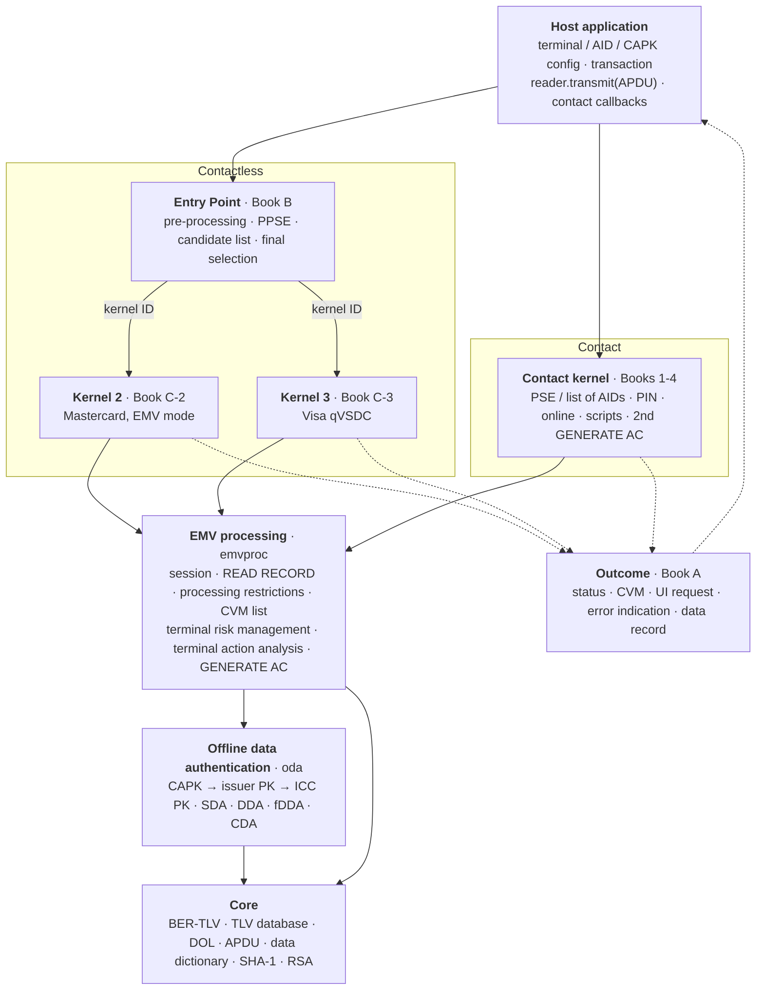
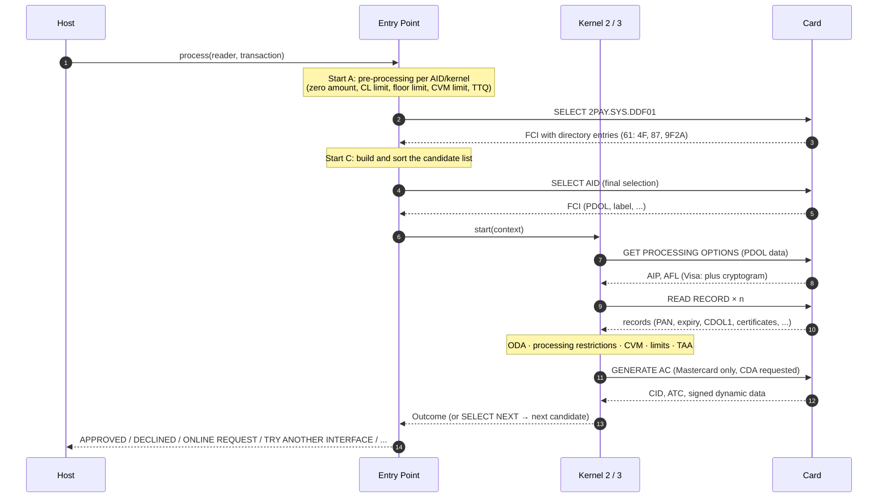
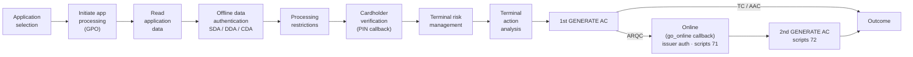

# OpenPayKernel: an open-source EMV Level 2 kernel

OpenPayKernel is a clean-room, open-source implementation of the EMV Level 2 payment
kernel. It comes as two implementations that behave the same way:

| | Python (`python/openpaykernel`) | C99 (`c/`) |
|---|---|---|
| Purpose | Reference, test bed, simulation, tooling | Embedded terminals: no malloc, no dependencies |
| Contact EMV (Books 1-4) | ✅ | ✅ |
| Contactless Entry Point (Book B) | ✅ | ✅ |
| Kernel 3: Visa qVSDC (Book C-3) | ✅ | ✅ |
| Kernel 2: Mastercard EMV mode (Book C-2) | ✅ | ✅ |
| ODA: SDA / DDA / fDDA / CDA (RSA, SHA-1) | ✅ | ✅ |
| Card simulator + key/certificate generator | ✅ | n/a (uses the generated vectors) |

> **Not certified.** A kernel needs EMVCo Level 2 type approval, and payment-brand approval,
> before it can process real payments. Use OpenPayKernel to learn, build test tools and simulators,
> and as a starting point for a certification project.

## Kernel structure

### Layers

The host application talks to the kernel through only three things: configuration, an
APDU `transmit` function and (for contact) a few callbacks. Everything below that is
layered so that both interfaces share the same EMV processing and cryptography.



### Contactless transaction flow



### Contact transaction flow



### Module map (Python ↔ C)

Each Python module has a matching C file, and the shared conformance vectors keep them behaving the same.

| Layer | Python `python/openpaykernel/` | C `c/src/` | Specification |
|---|---|---|---|
| Public API | `__init__.py` | `include/openpaykernel/openpaykernel.h` | — |
| TLV, TLV database, DOL, data dictionary | `tlv.py`, `dol.py`, `tags.py` | `opk_tlv.c` | Book 3 Annex A/B, §5.4 |
| APDU commands | `apdu.py` | `opk_emvproc.c` | Book 3 §6 |
| SHA-1, RSA | `hashlib`, `pow()` | `opk_crypto.c` | Book 2 Annex B |
| CAPK store, ODA | `capk.py`, `oda.py` | `opk_oda.c` | Book 2 §5–6 |
| Shared EMV processing | `emvproc.py` | `opk_emvproc.c` | Book 3 §10, Book 4 §6 |
| Configuration | `config.py` | `opk_env`, `opk_*_config` | — |
| Outcome | `outcome.py` | `opk_outcome` | Book A §6 |
| Entry Point | `entry_point.py` | `opk_entry_point.c` | Book B |
| Kernel 2 (Mastercard) | `kernels/mastercard.py` | `opk_mastercard.c` | Book C-2 |
| Kernel 3 (Visa) | `kernels/visa.py` | `opk_visa.c` | Book C-3 |
| Contact kernel | `contact.py` | `opk_contact.c` | Books 1–4 |
| Card simulator | `sim/card.py`, `sim/rsa.py` | — (replays vectors) | — |

### Design principles

- **No hardware coupling.** All card I/O goes through `transmit(C-APDU) → R-APDU`, so the
  same kernel runs on PC/SC, an NFC controller, the simulator or a recorded transcript.
- **One result type.** Contact and contactless kernels both return the Book A Outcome.
- **Card data can't overwrite terminal data.** Terminal-sourced tags are protected in the
  transaction's TLV database.
- **Deterministic.** Unpredictable numbers come from an injected RNG, which is what makes
  byte-exact cross-language testing possible.
- **Embedded-friendly C.** C99, no `malloc`, no global mutable state, no dependencies.

## Quick start

```bash
# Python (3.10+, no runtime dependencies)
cd python
python3 -m pytest              # 38 tests: unit, end-to-end, robustness
python3 examples/demo.py       # three transactions against the card simulator

# C (CMake ≥ 3.13, any C99 compiler)
cd c
cmake -S . -B build && cmake --build build
ctest --test-dir build         # unit tests + 19 cross-language conformance vectors
```

### Python: contactless

```python
from openpaykernel import AidConfig, CAPKStore, Environment, EntryPoint, MastercardKernel, TerminalConfig, Transaction, VisaKernel

env = Environment(TerminalConfig(), aids=[AidConfig(bytes.fromhex("A0000000031010"), kernel_id=3,
                                                    cl_transaction_limit=50000, cvm_required_limit=3000)],
                  capks=my_capk_store)
ep = EntryPoint(env, [VisaKernel(), MastercardKernel()])
outcome = ep.process(reader, Transaction(amount=1250))   # reader.transmit(apdu) -> rapdu
print(outcome.status, outcome.cvm, outcome.data_record)
```

### C: contact

```c
opk_env env = {0};
opk_terminal_defaults(&env.terminal);
opk_aid_defaults(&env.aids[env.aid_count++], visa_aid, 7);
env.rng = my_rng;                       /* terminal unpredictable numbers */
opk_env_add_capk(&env, &capk);

opk_transaction txn;  opk_transaction_defaults(&txn, 2000);
opk_reader reader = { my_transmit, my_ctx };
opk_contact_host host = { choose_app, enter_pin, go_online, my_ctx };
opk_outcome out;  static opk_db db;
opk_contact_process(&env, &txn, &reader, &host, &out, &db);
```

## How the two implementations stay in sync

`python/tests/gen_vectors.py` runs the Python kernels against the simulated card. For each
scenario it writes the configuration, every APDU exchanged and the expected outcome to
`c/tests/vectors/*.txt`. The C test-suite replays the card side and requires **identical
command APDUs** and an identical outcome. Any behavioural change shows up as a
conformance failure.

Robustness: both implementations are fuzzed with corrupted card responses (Python sweep;
C under AddressSanitizer and UBSan, `OPK_FUZZ=<n> ./build/test_vectors tests/vectors/*.txt`).

## Repository layout

```
openpaykernel/
├── python/
│   ├── openpaykernel/
│   │   ├── tlv.py dol.py tags.py apdu.py      core encoding + commands
│   │   ├── capk.py oda.py                     keys + offline data authentication
│   │   ├── config.py outcome.py               configuration + Book A outcome
│   │   ├── emvproc.py                         shared Book 3/4 processing steps
│   │   ├── entry_point.py                     contactless Entry Point (Book B)
│   │   ├── kernels/visa.py                    Kernel 3 (Book C-3)
│   │   ├── kernels/mastercard.py              Kernel 2 (Book C-2)
│   │   ├── contact.py                         contact kernel (Books 1-4)
│   │   └── sim/                               card simulator, RSA + certificate builder
│   ├── tests/                                 unit, end-to-end, robustness, vector generator
│   └── examples/demo.py
├── c/
│   ├── include/openpaykernel/openpaykernel.h  public API
│   ├── src/opk_*.c                            C implementation (same module split)
│   └── tests/                                 unit tests, vector replay + fuzzer, vectors/
├── docs/                                      ARCHITECTURE.md, CLEAN_ROOM.md
└── .github/workflows/ci.yml                   Python + C + sanitizer CI
```

## Roadmap

- Kernel 2: mag-stripe mode, Data Exchange (DEK/DET), torn-transaction recovery, relay
  resistance, IDS/data storage
- Kernel 3: Issuer Update Processing
- Kernels 4 (Amex), 5 (JCB), 6 (Discover), 7 (UnionPay), RuPay, Mir, and the new C-8 kernel
- ECC ODA (Book E) and SM2/SM3
- PC/SC reader adapter and a terminal CLI
- Issuer-side cryptogram (ARQC) verification for host simulators

See [docs/ARCHITECTURE.md](docs/ARCHITECTURE.md) for the design and
[docs/CLEAN_ROOM.md](docs/CLEAN_ROOM.md) for how this code was produced.

## License

Apache-2.0. EMV® is a registered trademark of EMVCo, LLC. This project is not affiliated with
or endorsed by EMVCo or any payment brand.
