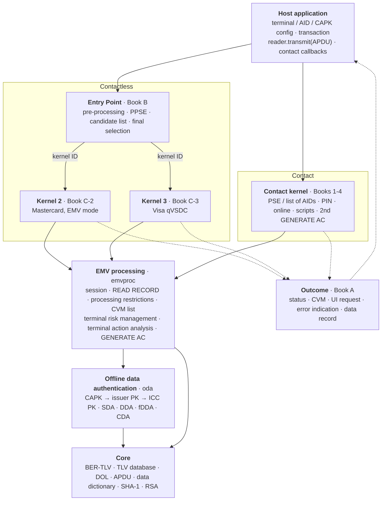
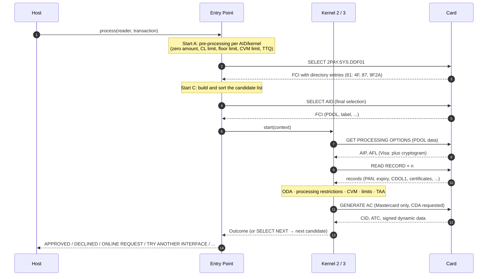
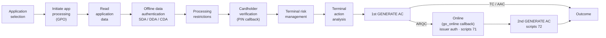
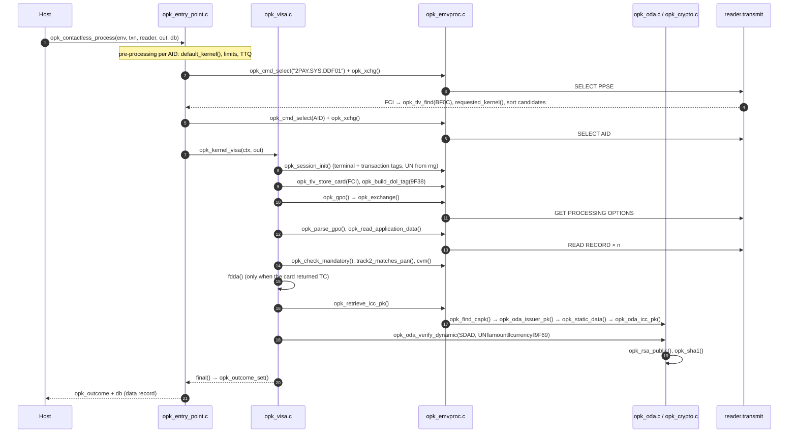

# OpenPayKernel: an open-source EMV Level 2 kernel

OpenPayKernel is a clean-room, open-source implementation of the EMV Level 2 payment
kernel. It comes as two implementations that behave the same way:

| | Python (`python/openpaykernel`) | C99 (`c/`) |
|---|---|---|
| Purpose | Reference, test bed, simulation, tooling | Embedded terminals: no malloc, no dependencies |
| Contact EMV (Books 1-4) | ✅ | ✅ |
| Contactless Entry Point (Book B) | ✅ | ✅ |
| Kernel 3: Visa qVSDC (Book C-3) | ✅ | ✅ |
| Kernel 2: Mastercard EMV mode (Book C-2) | ✅ | ✅ |
| ODA: SDA / DDA / fDDA / CDA (RSA, SHA-1) | ✅ | ✅ |
| Card simulator + key/certificate generator | ✅ | n/a (uses the generated vectors) |

> **Not certified.** A kernel needs EMVCo Level 2 type approval, and payment-brand approval,
> before it can process real payments. Use OpenPayKernel to learn, build test tools and simulators,
> and as a starting point for a certification project.

## Kernel structure

### Layers

The host application talks to the kernel through only three things: configuration, an
APDU `transmit` function and (for contact) a few callbacks. Everything below that is
layered so that both interfaces share the same EMV processing and cryptography.



### Contactless transaction flow



### Contact transaction flow



### Module map (Python ↔ C)

Each Python module has a matching C file, and the shared conformance vectors keep them behaving the same.

| Layer | Python `python/openpaykernel/` | C `c/src/` | Specification |
|---|---|---|---|
| Public API | `__init__.py` | `include/openpaykernel/openpaykernel.h` | — |
| TLV, TLV database, DOL, data dictionary | `tlv.py`, `dol.py`, `tags.py` | `opk_tlv.c` | Book 3 Annex A/B, §5.4 |
| APDU commands | `apdu.py` | `opk_emvproc.c` | Book 3 §6 |
| SHA-1, RSA | `hashlib`, `pow()` | `opk_crypto.c` | Book 2 Annex B |
| CAPK store, ODA | `capk.py`, `oda.py` | `opk_oda.c` | Book 2 §5–6 |
| Shared EMV processing | `emvproc.py` | `opk_emvproc.c` | Book 3 §10, Book 4 §6 |
| Configuration | `config.py` | `opk_env`, `opk_*_config` | — |
| Outcome | `outcome.py` | `opk_outcome` | Book A §6 |
| Entry Point | `entry_point.py` | `opk_entry_point.c` | Book B |
| Kernel 2 (Mastercard) | `kernels/mastercard.py` | `opk_mastercard.c` | Book C-2 |
| Kernel 3 (Visa) | `kernels/visa.py` | `opk_visa.c` | Book C-3 |
| Contact kernel | `contact.py` | `opk_contact.c` | Books 1–4 |
| Card simulator | `sim/card.py`, `sim/rsa.py` | — (replays vectors) | — |

### Design principles

- **No hardware coupling.** All card I/O goes through `transmit(C-APDU) → R-APDU`, so the
  same kernel runs on PC/SC, an NFC controller, the simulator or a recorded transcript.
- **One result type.** Contact and contactless kernels both return the Book A Outcome.
- **Card data can't overwrite terminal data.** Terminal-sourced tags are protected in the
  transaction's TLV database.
- **Deterministic.** Unpredictable numbers come from an injected RNG, which is what makes
  byte-exact cross-language testing possible.
- **Embedded-friendly C.** C99, no `malloc`, no global mutable state, no dependencies.

## Call sequence

The diagrams below trace the actual function calls. Names are from the C library; the
Python reference uses the same structure (see the name map at the end of this section).

### Function-level sequence: contactless Visa transaction



### Call trees

Each line is a function call in execution order. `[APDU]` marks a card command and
`{callback}` marks a host callback.

**Contactless: Entry Point (Book B)**

```text
opk_contactless_process()                         opk_entry_point.c
├── pre-processing loop: default_kernel(), limit checks, TTQ build
├── opk_cmd_select() + opk_xchg()                 [APDU] SELECT 2PAY.SYS.DDF01
├── opk_tlv_check() / opk_tlv_next() / opk_tlv_find(BF0C)
├── for each 61 entry: requested_kernel(), AID match → candidate list, sort by priority
└── for each candidate:
    ├── opk_cmd_select() + opk_xchg()             [APDU] SELECT AID
    ├── opk_kernel_visa()  or  opk_kernel_mastercard()
    └── outcome SELECT_NEXT → next candidate, otherwise return
```

**Kernel 3: Visa qVSDC (Book C-3)**

```text
opk_kernel_visa()                                 opk_visa.c
├── opk_session_init()                            terminal/transaction tags, 9F37 from rng
├── opk_tlv_store_card(FCI)                       card can't overwrite terminal tags
├── opk_dol_contains(PDOL, 9F66) → opk_build_dol_tag(9F38)
├── opk_gpo() → opk_exchange() → opk_xchg()       [APDU] GET PROCESSING OPTIONS
│   └── SW 6984 → tai() · 6985 → select_next() · 6986 → TRY AGAIN "see phone"
├── opk_parse_gpo()                               AIP, AFL, cryptogram, CTQ, SDAD
├── opk_read_application_data()                   [APDU] READ RECORD × n, collect ODA static data
├── opk_check_mandatory(), track2_matches_pan()
├── cvm()                                         CTQ/TTQ: online PIN, CDCVM, signature or none
├── CID = AAC → DECLINED · ARQC → ONLINE REQUEST
└── CID = TC:
    ├── opk_valid_date() / opk_yymmdd()           expiry
    ├── opk_pan_on_exception_file()
    ├── fdda()
    │   ├── opk_retrieve_icc_pk()
    │   │   ├── opk_retrieve_issuer_pk() → opk_find_capk() → opk_oda_issuer_pk()
    │   │   └── opk_static_data() → opk_oda_icc_pk()
    │   └── opk_oda_verify_dynamic() → opk_rsa_public(), opk_sha1()
    └── final(APPROVED) — on failure: CTQ rules → ONLINE / TRY ANOTHER INTERFACE / DECLINED
```

**Kernel 2: Mastercard EMV mode (Book C-2)**

```text
opk_kernel_mastercard()                           opk_mastercard.c
├── opk_session_init(), opk_tlv_store_card(FCI)
├── opk_build_dol_tag(9F38) → opk_gpo()           [APDU] GET PROCESSING OPTIONS
├── opk_parse_gpo()                               EMV mode check (AIP + DF811B)
├── opk_read_application_data()                   [APDU] READ RECORD × n
├── opk_check_mandatory(5F24, 5A, 8C, 8D)
├── CDA selection: AIP + DF811F, opk_find_capk()
├── opk_processing_restrictions()                 version, AUC, dates, exception file → TVR
├── on-device CVM (9F34 = 010002)  or  opk_cvm_list_processing() with DF8118/DF8119
├── reader limits DF8124/DF8125 → select_next(MAX_LIMIT_EXCEEDED), floor limit DF8123
├── opk_terminal_action_analysis()                TAC DF8120-22 + IAC → AAC / TC / ARQC
├── opk_build_dol_tag(8C) → opk_cmd() + opk_exchange()   [APDU] GENERATE AC (+CDA)
├── opk_parse_generate_ac()
├── CDA: opk_retrieve_icc_pk() → opk_oda_verify_cda()   (PDOL‖CDOL1‖response hash)
└── final()                                       TC → APPROVED · ARQC → ONLINE · AAC → DECLINED
```

**Contact kernel (Books 1-4)**

```text
opk_contact_process()                             opk_contact.c
├── pse()                                         [APDU] SELECT 1PAY.SYS.DDF01, READ RECORD (directory)
│   └── no match → list_of_aids()                 [APDU] SELECT AID (first / next occurrence)
├── sort by priority → {choose_application}       when several apps or confirmation needed
├── opk_cmd_select() + opk_xchg()                 [APDU] SELECT AID
├── opk_session_init()
└── process_app()
    ├── opk_tlv_store_card(FCI), opk_build_dol_tag(9F38)
    ├── opk_gpo()                                 [APDU] GET PROCESSING OPTIONS (6985 → next app)
    ├── opk_parse_gpo(), opk_read_application_data()   [APDU] READ RECORD × n
    ├── opk_check_mandatory(5F24, 5A, 8C, 8D)
    ├── do_oda()
    │   ├── CDA: opk_retrieve_icc_pk()            (signature checked later in generate_ac)
    │   ├── DDA: opk_retrieve_icc_pk() → [APDU] INTERNAL AUTHENTICATE → opk_oda_verify_dynamic()
    │   └── SDA: opk_retrieve_issuer_pk() → opk_static_data() → opk_oda_verify_sda()
    ├── opk_processing_restrictions()
    ├── opk_cvm_list_processing() → perform_pin()
    │   ├── online PIN: {enter_pin}
    │   └── offline PIN: [APDU] GET DATA 9F17 → {enter_pin} →
    │       plaintext [APDU] VERIFY  or  enciphered_verify(): [APDU] GET CHALLENGE, opk_rsa_public(), VERIFY
    ├── opk_terminal_risk_management()            floor limit, random selection, [APDU] GET DATA 9F36/9F13
    ├── opk_terminal_action_analysis()
    ├── generate_ac(CDOL1)                        [APDU] GENERATE AC #1 (+ opk_oda_verify_cda)
    │   └── TC → APPROVED · AAC → DECLINED
    └── ARQC:
        ├── {go_online}                           or unable → opk_default_action()
        ├── [APDU] EXTERNAL AUTHENTICATE          91 present, AIP issuer auth bit set, 91 not in CDOL2
        ├── run_scripts(71)                       [APDU] issuer script commands
        ├── generate_ac(CDOL2)                    [APDU] GENERATE AC #2
        ├── run_scripts(72)
        └── finish()
```

Every card command goes through `opk_exchange()` → `opk_xchg()` → `reader.transmit()`. This
path handles `61xx` (GET RESPONSE) and `6Cxx` (wrong Le) the same way for all kernels.

### Python ↔ C name map

| C (`c/src/`) | Python (`python/openpaykernel/`) |
|---|---|
| `opk_contactless_process()` | `EntryPoint.process()` → `preprocess()`, `build_candidates()` |
| `opk_kernel_visa()` / `opk_kernel_mastercard()` | `VisaKernel.start()` / `MastercardKernel.start()` |
| `opk_contact_process()` / `process_app()` | `ContactKernel.process()` / `_process_app()` |
| `pse()` / `list_of_aids()` | `ContactKernel._pse()` / `_list_of_aids()` |
| `do_oda()` / `perform_pin()` / `enciphered_verify()` | `_oda()` / `_perform_pin()` / `_enciphered_verify()` |
| `generate_ac()` / `run_scripts()` / `finish()` | `_generate_ac()` / `_run_scripts()` / `_finish()` |
| `opk_session_init()` | `emvproc.Session.new()` |
| `opk_read_application_data()`, `opk_processing_restrictions()`, `opk_cvm_list_processing()`, `opk_terminal_risk_management()`, `opk_terminal_action_analysis()`, `opk_parse_generate_ac()` | `emvproc.read_application_data()`, `processing_restrictions()`, `cvm_list_processing()`, `terminal_risk_management()`, `terminal_action_analysis()`, `parse_generate_ac()` |
| `opk_retrieve_issuer_pk()` / `opk_retrieve_icc_pk()` | `emvproc.retrieve_issuer_pk()` / `retrieve_icc_pk()` |
| `opk_oda_issuer_pk()` / `opk_oda_icc_pk()` | `oda.recover_issuer_pk()` / `recover_icc_pk()` |
| `opk_oda_verify_sda()` / `_dynamic()` / `_cda()` | `oda.verify_sda()` / `verify_dynamic_signature()` / `verify_cda()` |
| `opk_exchange()` / `opk_xchg()` | `apdu.Channel.exchange()` |

## Quick start

```bash
# Python (3.10+, no runtime dependencies)
cd python
python3 -m pytest              # 38 tests: unit, end-to-end, robustness
python3 examples/demo.py       # three transactions against the card simulator

# C (CMake ≥ 3.13, any C99 compiler)
cd c
cmake -S . -B build && cmake --build build
ctest --test-dir build         # unit tests + 19 cross-language conformance vectors
```

### Python: contactless

```python
from openpaykernel import AidConfig, CAPKStore, Environment, EntryPoint, MastercardKernel, TerminalConfig, Transaction, VisaKernel

env = Environment(TerminalConfig(), aids=[AidConfig(bytes.fromhex("A0000000031010"), kernel_id=3,
                                                    cl_transaction_limit=50000, cvm_required_limit=3000)],
                  capks=my_capk_store)
ep = EntryPoint(env, [VisaKernel(), MastercardKernel()])
outcome = ep.process(reader, Transaction(amount=1250))   # reader.transmit(apdu) -> rapdu
print(outcome.status, outcome.cvm, outcome.data_record)
```

### C: contact

```c
opk_env env = {0};
opk_terminal_defaults(&env.terminal);
opk_aid_defaults(&env.aids[env.aid_count++], visa_aid, 7);
env.rng = my_rng;                       /* terminal unpredictable numbers */
opk_env_add_capk(&env, &capk);

opk_transaction txn;  opk_transaction_defaults(&txn, 2000);
opk_reader reader = { my_transmit, my_ctx };
opk_contact_host host = { choose_app, enter_pin, go_online, my_ctx };
opk_outcome out;  static opk_db db;
opk_contact_process(&env, &txn, &reader, &host, &out, &db);
```

## How the two implementations stay in sync

`python/tests/gen_vectors.py` runs the Python kernels against the simulated card. For each
scenario it writes the configuration, every APDU exchanged and the expected outcome to
`c/tests/vectors/*.txt`. The C test-suite replays the card side and requires **identical
command APDUs** and an identical outcome. Any behavioural change shows up as a
conformance failure.

Robustness: both implementations are fuzzed with corrupted card responses (Python sweep;
C under AddressSanitizer and UBSan, `OPK_FUZZ=<n> ./build/test_vectors tests/vectors/*.txt`).

## Repository layout

```
openpaykernel/
├── README.md · LICENSE (Apache-2.0)
├── .github/workflows/ci.yml          Python 3.10-3.13 · C on Linux/macOS (gcc, clang) · ASan/UBSan fuzz
├── docs/
│   ├── ARCHITECTURE.md               design decisions, data flow, testing strategy
│   └── CLEAN_ROOM.md                 how the code was produced, contributor rules
│
├── python/                           ── Python reference implementation ──
│   ├── pyproject.toml
│   ├── openpaykernel/
│   │   ├── __init__.py               public API exports
│   │   ├── tlv.py                    BER-TLV parse/encode, TLVDatabase (protects terminal tags)
│   │   ├── dol.py                    DOL parsing and building (n / cn / an / b padding rules)
│   │   ├── tags.py                   EMV data dictionary: name, format, source
│   │   ├── apdu.py                   command builders, Reader protocol, Channel (61xx/6Cxx)
│   │   ├── capk.py                   CA public keys, checksum, expiry, revocation list
│   │   ├── oda.py                    certificate recovery, SDA / DDA / fDDA / CDA checks
│   │   ├── config.py                 TerminalConfig, AidConfig, Transaction, Environment, Bits
│   │   ├── outcome.py                Book A Outcome, status/CVM/message enums, error indication
│   │   ├── emvproc.py                Session + shared steps: records, restrictions, CVM, TRM, TAA
│   │   ├── entry_point.py            contactless Entry Point: pre-processing, PPSE, candidates
│   │   ├── kernels/visa.py           Kernel 3: Visa qVSDC (Book C-3)
│   │   ├── kernels/mastercard.py     Kernel 2: Mastercard EMV mode (Book C-2)
│   │   ├── contact.py                contact kernel + ContactHost callbacks + AutoHost
│   │   └── sim/
│   │       ├── rsa.py                deterministic RSA keys + EMV certificate/signature builders
│   │       └── card.py               configurable simulated card (contact, Visa, Mastercard)
│   ├── tests/
│   │   ├── scenarios.py              shared configs, simulated cards, deterministic RNG
│   │   ├── test_core.py              TLV, DOL, CAPK, certificate chain, CDA binding
│   │   ├── test_kernels.py           end-to-end transactions (29 scenarios)
│   │   ├── test_robustness.py        corrupted card responses never raise
│   │   └── gen_vectors.py            writes c/tests/vectors/*.txt from the Python reference
│   └── examples/demo.py              three transactions with an APDU trace
│
└── c/                                ── C99 implementation (no malloc, no dependencies) ──
    ├── CMakeLists.txt                library `openpaykernel` + tests (ctest)
    ├── include/openpaykernel/
    │   └── openpaykernel.h           public API: TLV database, config, outcome, reader,
    │                                 host callbacks, opk_contactless_process(), opk_contact_process()
    ├── src/
    │   ├── opk_internal.h            internal interfaces shared by the .c files (session, TVR/TSI macros)
    │   ├── opk_tlv.c                 BER-TLV (opk_tlv_next/find/check/encode), TLV database
    │   │                             (opk_db_set/get/del), card-data store (opk_tlv_store_card),
    │   │                             data dictionary (opk_tag_format), DOL (opk_dol_build)
    │   ├── opk_crypto.c              SHA-1 (opk_sha1*), RSA public operation with Montgomery
    │   │                             multiplication (opk_rsa_public)
    │   ├── opk_oda.c                 certificate recovery (opk_oda_issuer_pk, opk_oda_icc_pk) and
    │   │                             signature checks (opk_oda_verify_sda/_dynamic/_cda)
    │   ├── opk_emvproc.c             defaults (opk_*_defaults), session (opk_session_init), APDU
    │   │                             transport (opk_cmd, opk_xchg, opk_exchange, opk_gpo), records
    │   │                             (opk_read_application_data), ODA key chain, processing
    │   │                             restrictions, CVM list, terminal risk management, terminal
    │   │                             action analysis, GENERATE AC parsing
    │   ├── opk_entry_point.c         opk_contactless_process(): pre-processing, PPSE, kernel ID
    │   │                             resolution, candidate sort, final selection, kernel dispatch
    │   ├── opk_visa.c                opk_kernel_visa(): GPO, records, CTQ/TTQ CVM, fDDA, outcome
    │   ├── opk_mastercard.c          opk_kernel_mastercard(): GPO, records, CVM, limits, TAA,
    │   │                             GENERATE AC with CDA, outcome
    │   └── opk_contact.c             opk_contact_process(): PSE / list of AIDs, ODA, PIN
    │                                 (plaintext + enciphered), online, scripts, 2nd GENERATE AC
    └── tests/
        ├── test_core.c               TLV, TLV database, DOL, SHA-1 and RSA unit tests
        ├── test_vectors.c            replays vectors byte for byte; OPK_FUZZ=<n> corrupts responses
        └── vectors/*.txt             19 conformance vectors generated by python/tests/gen_vectors.py
```

## Roadmap

- Kernel 2: mag-stripe mode, Data Exchange (DEK/DET), torn-transaction recovery, relay
  resistance, IDS/data storage
- Kernel 3: Issuer Update Processing
- Kernels 4 (Amex), 5 (JCB), 6 (Discover), 7 (UnionPay), RuPay, Mir, and the new C-8 kernel
- ECC ODA (Book E) and SM2/SM3
- PC/SC reader adapter and a terminal CLI
- Issuer-side cryptogram (ARQC) verification for host simulators

See [docs/ARCHITECTURE.md](docs/ARCHITECTURE.md) for the design and
[docs/CLEAN_ROOM.md](docs/CLEAN_ROOM.md) for how this code was produced.

## License

Apache-2.0. EMV® is a registered trademark of EMVCo, LLC. This project is not affiliated with
or endorsed by EMVCo or any payment brand.
